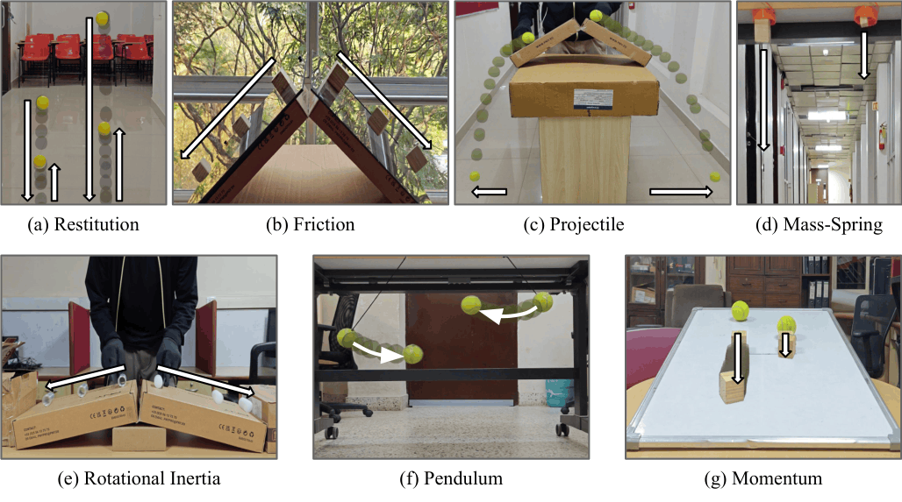

# Principia

**A benchmark for physical consistency in video generation models.**

[](https://huggingface.co/datasets/varunvarmat/Principia)

<p align="center">
  
</p>

Principia tests whether generated videos obey simple physical laws. Each sample
is a real first frame showing two objects in a controlled setup. A model
generates a video from that frame, both objects are tracked with
[SAM3](https://github.com/facebookresearch/sam3), and the measured motion is
checked against the relationship physics predicts between the two objects.

## Scenarios

| Scenario | Setup | What is checked |
|---|---|---|
| `coeff_friction` | Two objects slide down inclines | Frames at which each object reaches the ground |
| `moment_of_inertia` | A hollow and a solid object roll down inclines | Ratio of ground-contact frames vs. the predicted 2/√3 |
| `restitution` | Two balls are dropped and bounce | Coefficient of restitution of each ball, √(rebound / drop) |
| `gravity` | Scored from the `restitution` videos | Drop-height ratio vs. squared time-of-flight ratio (h ∝ t²) |
| `spring` | Two masses hang from springs | Mass ratio vs. extension ratio (Hooke's law) |
| `pendulum` | Two pendulums swing | Length ratio vs. squared period ratio (T² ∝ L) |
| `projectile` | Two balls roll off ledges | The ball released higher lands further away |
| `conservation_of_momentum` | Two objects of known masses are set in motion | The higher-placed object, or at equal heights the lighter one, travels further |

## Installation

```bash
git clone https://github.com/<org>/Principia.git
cd Principia
pip install -r requirements.txt
```

SAM3 checkpoints are gated on Hugging Face: request access to
[facebook/sam3](https://huggingface.co/facebook/sam3) and log in with
`hf auth login` before running the evaluation. A CUDA GPU is required for
tracking.

## Dataset

The dataset is hosted on Hugging Face at
[varunvarmat/Principia](https://huggingface.co/datasets/varunvarmat/Principia).
Download it next to your model outputs (or pass its location with
`--reference-dir`):

```bash
hf download varunvarmat/Principia --repo-type dataset --local-dir Principia
```

```
Principia/
└── <scenario>/
    └── sample_<n>/
        ├── frame_0000.png    # conditioning frame
        └── metadata.json     # annotated object points and scenario parameters
```

Frames are 1280×720, except `restitution` and `spring`, which are 720×1280.

## Generating videos

Generate one video per sample, conditioned on its `frame_0000.png`, and save
it using the same scenario and sample names:

```
<model_dir>/
└── <scenario>/
    └── sample_<n>/
        └── video.mp4
```

Scenarios or samples that are missing are skipped. To average over seeds,
write each seed to its own model directory.

The text prompts used for generation are in [`prompts.json`](prompts.json),
keyed by scenario. `gravity` has no entry because it is scored from the
`restitution` videos. `conservation_of_momentum` has two prompts: use
`same_height_different_mass` for samples where the balls start at the same
height, and `different_height_same_mass` for samples where they start at
different heights.

## Evaluation

Run all the stages on one model:

```bash
cd src
python -m principia /path/to/<model_dir>
python -m principia /path/to/<model_dir> --scenarios pendulum spring
```

This runs three stages, which can also be run on their own:

```bash
# 1. Track objects and compute per-sample measurements -> results.json
python -m principia.scenarios.pendulum /path/to/<model_dir>

# 2. Directional-consistency filtering -> direction_consistency_*.json
python -m principia.direction_consistency /path/to/<model_dir>

# 3. Invariance score (several directories are averaged per sample, e.g. seeds)
python -m principia.invariance_score /path/to/<model>_seed_42 /path/to/<model>_seed_123
```

Useful options: `--reference-dir` (dataset root, default `<model_dir>/../Principia`),
`--skip-existing` (do not re-track samples that already have results),
`--max-frames` (default 240) and `--save scores.json` for the invariance score.

## Scoring

1. **Per-sample score.** For ratio-based scenarios, the two measured
   quantities `o1` and `o2` are compared with a symmetric relative
   difference: `score = 1 - |o1 - o2| / (|o1| + |o2|)`. Missing
   measurements score 0. `projectile` and `conservation_of_momentum` score 1
   if the predicted ordering holds and 0 otherwise. Samples whose reference
   gives no expected ordering are ignored.
2. **Directional filter.** Each object must move in the expected direction:
   downward for every scenario, and horizontally for `pendulum`. For each
   frame-to-frame step, only one axis of motion is considered: +1 if the
   step moves the expected way, −1 if not; steps under 2 px are ignored.
   A sample whose two objects do not both reach a mean of at least 0.8
   scores 0.
3. **Aggregation.** Each sample's score is averaged across seeds. The
   scenario score is the mean over its samples, and the final score is the
   mean over the scenarios that have results.

## Outputs

| File | Contents |
|---|---|
| `<model_dir>/<scenario>/sample_<n>/results.json` | Tracks and measurements for one sample |
| `<model_dir>/<scenario>/sample_<n>/direction_consistency_*_only.json` | Directional-consistency scores |
| `<model_dir>/<scenario>/failures.json` | Samples that failed, with the error |
| `<model_dir>/eval_summary.json` | Status of each scenario |

## Citation

```bibtex
@misc{thozhiyoor2026principiarelationalphysicstests,
      title={Principia: Relational Physics Tests for Video Models},
      author={Varun Varma Thozhiyoor and Shivam Tripathi and Venkatesh Babu Radhakrishnan and Anand Bhattad},
      year={2026},
      eprint={2609.04200},
      archivePrefix={arXiv},
      primaryClass={cs.CV},
      url={https://arxiv.org/abs/2609.04200},
}

@InProceedings{Thozhiyoor_2026_CVPR,
    author    = {Thozhiyoor, Varun Varma and Tripathi, Shivam and Radhakrishnan, Venkatesh Babu and Bhattad, Anand},
    title     = {Objects in Generated Videos Are Slower Than They Appear: Models Suffer Sub-Earth Gravity and Don't Know Galileo's Principle...for now},
    booktitle = {Proceedings of the IEEE/CVF Conference on Computer Vision and Pattern Recognition (CVPR) Findings},
    month     = {June},
    year      = {2026},
    pages     = {3830--3839}
}
```
